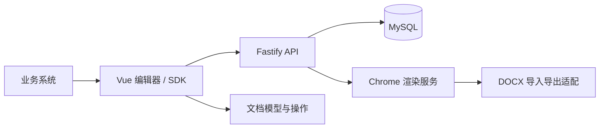

# Online Contract Editor · 在线合同编辑器

基于 Vue 3、TypeScript 和 canvas-editor 的开源合同编辑器与模板设计器。支持业务数据联填、Word 导入、PDF / DOCX 导出，通过 SDK 和 API 嵌入业务系统。

[English](README.en.md) · [开源说明与搜索词](docs/open-source.md) · [MIT License](LICENSE)

**开发预览版：主要功能已实现，整体验收尚未完成。** Word 排版保真仍有已知差异，详见下文。

## 功能

- 编辑、填写、盖章、只读四种模式。
- 模板字段插入、选中文本设为字段、Word 空白识别、预览与发布。
- 客户联选、字典快照、订单数据预填、只读字段与重复字段同步。
- 明细表循环、可编辑区域、金额大写、图片与印章图片。
- DOCX 导入和导入报告，PDF / DOCX 导出、打印。
- Vue 编辑器组件、宿主 SDK、模板与文档 API、访问令牌与版本控制。

印章功能用于放置印章图片，不提供证书签名或签名验证。

## 本地运行

当前验证环境：Windows、Node.js 24、pnpm 10.14.0、系统 Google Chrome。其他平台尚未完成验证。

```powershell
pnpm install --frozen-lockfile
pnpm exec tsx apps/demo/scripts/stack.ts
```

打开 `http://127.0.0.1:5173`。演示脚本会启动临时 MySQL 8、API（3100）、渲染服务（3200）和前端（5173）。首次运行需要下载 MySQL，退出脚本后临时数据库数据不保留。

依赖安装默认使用 `.npmrc` 配置的镜像源。渲染服务默认使用 Windows 字体和 Chrome 安装路径；可通过 `CHROME_PATH`、`FONT_CONFIG` 配置，格式见 [渲染配置](apps/renderer/src/config.ts) 和 [字体加载](apps/renderer/src/fonts.ts)。仓库不分发字体。

## 结构



| 目录 | 包 | 作用 |
| --- | --- | --- |
| `packages/core` | `@oe/core` | 文档 JSON 操作库，纯函数，浏览器和 Node 共用；`src/types.ts` 是各包之间的接口约定 |
| `packages/docx` | `@oe/docx` | canvas-editor DOCX 插件的适配与修正、导入报告 |
| `packages/web` | `@oe/web` | Vue 3 编辑器组件、模板设计器和 SDK |
| `apps/server` | `@oe/server` | 服务端：模板、文档、令牌、操作接口（Fastify + MySQL 8） |
| `apps/renderer` | `@oe/renderer` | 渲染服务：无头 Chrome 页面池，出 PDF、docx、页数 |
| `apps/demo` | `@oe/demo` | 演示宿主页：模拟业务系统接入 |
| `e2e` | | 端到端测试；`helpers/serve.ts` 起本地静态服务 |

## 验证与已知限制

```powershell
pnpm lint
pnpm typecheck
pnpm test
pnpm e2e
```

端到端测试依赖系统 Chrome。涉及外部真实合同的测试通过 `OE_REAL_CONTRACT` 指定本机文件，默认跳过该场景；仓库不包含真实合同。

- Word 导入仍存在首行缩进、列表编号、字体替换和行距差异，可能改变分页；不承诺与 Word / WPS 像素一致。
- PDF 文字选择、权限与导出相关补充验收，以及 WPS 排版复核和最终整体验收，仍有待完成。
- 演示环境用于本地试用。生产接入需要自行配置持久化数据库、存储、宿主身份认证和密钥；配置入口见 [API 配置](apps/server/src/config.ts)。
- 工作区包暂未发布到 npm。
- 本次发布检查发现循环表格在两条数据路径间存在控件权限默认值的 JSON 差异，相关一致性测试未通过；另有服务端测试和清理钩子超时。详见 [验证记录](docs/verification.md)。

## 开源与贡献

项目采用 [MIT](LICENSE) 许可证，第三方依赖继续遵守各自许可证，见 [第三方说明](THIRD_PARTY_NOTICES.md)。欢迎提交问题和 PR；复现材料请使用合成数据，移除合同原文、个人信息、密钥和业务凭证。

搜索关键词：在线合同编辑器、合同模板设计器、业务数据联填、Word 导入、PDF 导出、文档自动化；online contract editor, document template designer, document automation, Vue 3, TypeScript, canvas-editor, DOCX, PDF generation.
